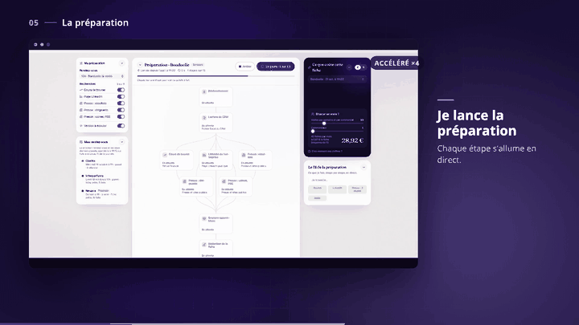
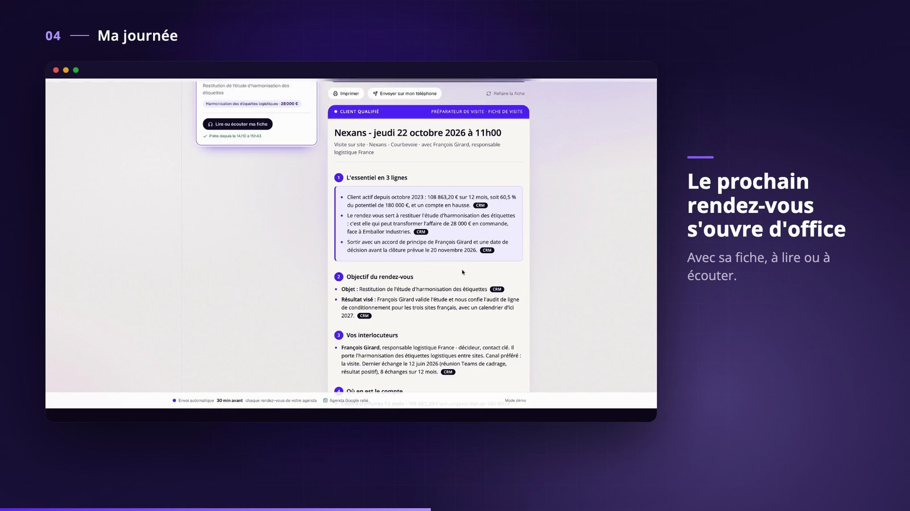
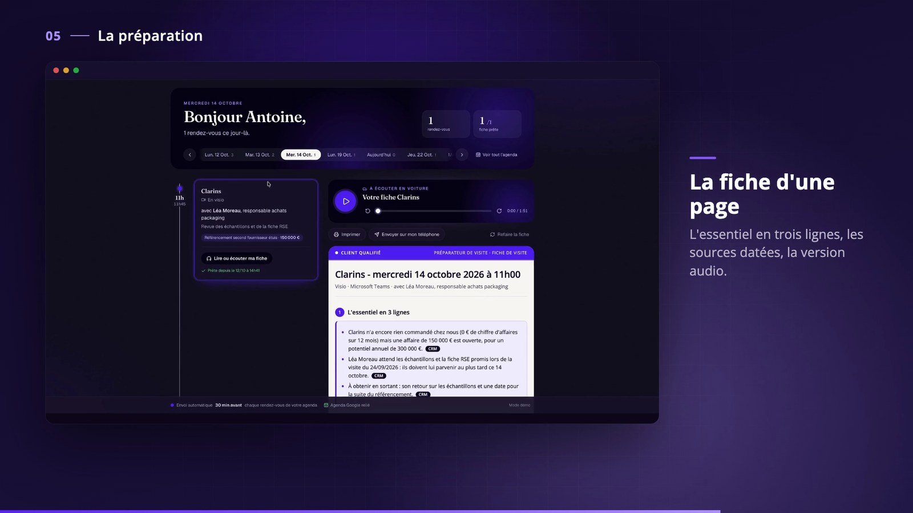
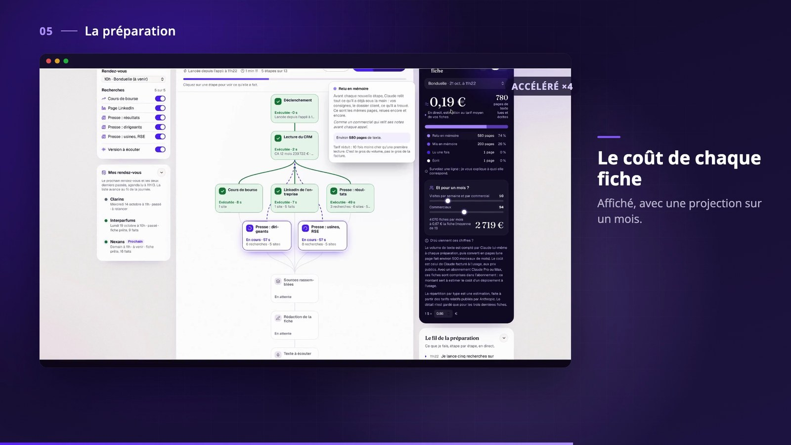

# Préparateur de visite commerciale

Un agent Claude qui prépare chaque rendez-vous d'un commercial terrain. Il lit le CRM, lance des recherches en parallèle (bourse, LinkedIn de l'entreprise, presse, enjeux du secteur), puis rédige une fiche d'une page à lire ou à écouter en voiture. La fiche arrive seule sur le téléphone 30 minutes avant le rendez-vous. Après la visite, le commercial dicte sa note, l'agent rédige le compte rendu, et rien n'entre dans le CRM sans sa validation.

Construit avec Claude Code en octobre 2026, comme démonstrateur d'un agent métier de bout en bout.



## Ce que ça fait

| Moment | Ce que voit le commercial |
|---|---|
| La veille | Ses rendez-vous du jour, chacun avec sa fiche prête ou en préparation |
| Pendant la préparation | Un schéma « Coulisses » : chaque recherche s'allume en direct, avec ses sources et son coût |
| En voiture | La fiche d'une page sur le téléphone et sa version audio de 2 minutes |
| Après la visite | Une note dictée, un compte rendu rédigé, puis la validation qui met à jour le CRM |
| Prospection | Une fiche dédiée aux nouveaux clients : interlocuteur, stratégie du rendez-vous, objections |

| | |
|---|---|
|  |  |
|  |  |

## Architecture

```
Mac (application de bureau)                         Téléphone (PWA)
  app/serveur.py   FastAPI, 127.0.0.1:8765              relais/mobile  React
  app/execution.py suivi des étapes en direct                 │
  claude -p        skills brief-visite,           relais/api  fonctions Vercel
                   brief-prospect,                 (clés par appareil, stockage
                   compte-rendu-visite              Vercel Blob privé)
  .claude/agents   un agent Sonnet par recherche          │
  scripts/         lecture/écriture du CRM Excel   ◄── ntfy ──┘
```

- **Agent** : Claude Code en mode non interactif (`claude -p`), piloté par des skills (`.claude/skills/`) et des sous-agents spécialisés (`.claude/agents/`). Aucune clé API : l'application utilise le compte Claude connecté sur le poste.
- **Garde-fous** : chaque fait venant d'internet est sourcé et daté. Les chiffres viennent du CRM et sont recalculés en Python (`scripts/verifier_calculs.py` les compare aux formules Excel). L'écriture dans le CRM n'a lieu qu'après validation.
- **Interface** : React, Tailwind, GSAP et motion-primitives (`app/web`). L'application Mac est assemblée avec pywebview (`scripts/fabriquer_app.sh`).
- **Téléphone** : une PWA servie par un relais Vercel. Le Mac reste maître des données, le relais ne fait que transmettre.

Détails et choix techniques : [`docs/architecture.md`](docs/architecture.md). Conception de la prospection : [`docs/prospection_conception.md`](docs/prospection_conception.md). Personas et user stories : [`docs/persona_user_stories_2026-10-15.md`](docs/persona_user_stories_2026-10-15.md).

## Sécurité

- Le serveur du Mac n'écoute que sur `127.0.0.1` et refuse les requêtes venues d'un autre site (contrôle de `Host` et d'`Origin`).
- L'agent ne peut pas modifier ses propres scripts, ni ses skills, ni l'application (`--disallowedTools`) : une page web malveillante lue pendant une recherche ne peut donc pas lui faire exécuter du code.
- Côté relais, les clés d'appareil sont révocables et stockées sous forme d'empreinte. La fiche est servie avec une politique de sécurité qui interdit tout script.
- Aucun secret n'est versionné : les fichiers de `config/` sont créés en local (modèles dans [`config/`](config/README.md)).

## Données de démonstration et données personnelles

Le CRM (`data/`, `CRM prospection/`) est **fictif**. L'entreprise Orvane Solutions, ses commerciaux, les contacts, les e-mails (domaines `.example`) et les téléphones (plages réservées à la fiction) sont inventés. Les entreprises clientes portent des noms réels pour que la veille web trouve de vraies actualités. En revanche, tout ce qui relève de la relation commerciale (contacts, affaires, commandes, réclamations) est imaginaire et ne décrit aucune relation réelle. Les fiches d'exemple sont dans [`sorties/`](sorties/LISEZ-MOI.md).

L'agent de prospection lit le profil public d'un interlocuteur pour adapter le ton du rendez-vous. Utilisé sur de vraies personnes, ce traitement demande une base légale au sens du RGPD (intérêt légitime documenté), une information de la personne concernée (article 14) et le respect des conditions d'utilisation de LinkedIn.

## Lancer en local

Prérequis : macOS, Python 3.12, Node.js, [Claude Code](https://docs.claude.com/en/docs/claude-code) installé et connecté (`claude auth login`).

```bash
python3 -m venv .venv && .venv/bin/pip install -r requirements.txt
cd app/web && npm install && npm run build && cd ../..
.venv/bin/python app/serveur.py      # http://127.0.0.1:8765
```

Chaque préparation consomme le quota de l'abonnement Claude connecté. Le relais téléphone est optionnel (`scripts/deployer_relais.sh`). Installation complète et fabrication du `.dmg` : [`docs/INSTALLATION.md`](docs/INSTALLATION.md).

## Méthode

Le projet a été construit en une semaine avec Claude Code, à partir de consignes de travail ([`CLAUDE.md`](CLAUDE.md)) et d'une fiche produit ([`PRODUCT.md`](PRODUCT.md)). Les audits UX successifs sont dans `docs/` (`audit_*.md`, `rapport_ui_fluidite_*.md`).
