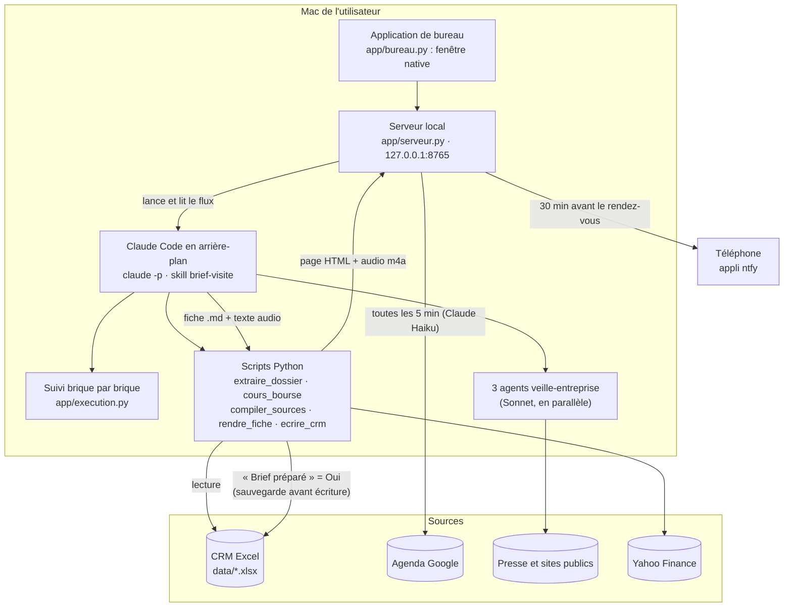

# Architecture

État au 12/10/2026, sur ce qui a réellement été construit. Périmètre : la préparation de visite. Le compte rendu après visite a été mis de côté par Antoine le 09/10.

## Schéma



## L'appli mobile et le relais (depuis le 12/10/2026)

```
iPhone (appli mobile)  ⇄  Vercel (relais : relais/api + stockage privé Blob)  ⇄  Mac (moteur : Claude, CRM, transcription)
```

- **Relais** (`relais/`, déployé sur Vercel, région Paris) : héberge l'appli mobile (`relais/mobile`, installable sur l'écran d'accueil) et quelques fonctions : `etat` (journée publiée par le Mac), `fichier` (fiches, audios, notes), `note` (dépôt d'une note vocale), `valider` (validation d'un compte rendu), `push` (notifications de l'appli), `sante`. Clés : `CLE_MOTEUR` (Mac), `CLE_ACCES` (téléphone, transmise par QR code).
- **Aucune interrogation en boucle** : le Mac publie seulement quand quelque chose change (`app/relais.py`), et le relais sonne le Mac par un canal ntfy privé (`CANAL_MOTEUR`) quand une note ou une validation arrive. Le Mac reprend après le dernier message traité (`config/relais_curseur.txt`).
- **Compte rendu** : note dictée dans l'appli mobile → relais → Mac : transcription locale (`scripts/transcrire.py`, faster-whisper « small », modèle téléchargé une fois dans `modeles/`) → skill `compte-rendu-visite` (Claude) → compte rendu et mises à jour proposées → notification « à valider » → validation sur le téléphone (ou le Mac) → `scripts/ecrire_crm.py --compte-rendu` (Rendez-vous « Réalisé », nouvelle ligne Activités avec formules recopiées et tableau agrandi, prochaine étape de l'affaire), sauvegarde et contrôle → notification « enregistré ».
- **Données dans le cloud** : la journée, les fiches, les notes vocales et les comptes rendus passent par le stockage privé Vercel. Acceptable pour la démonstration (données fictives, usage personnel), à valider avant tout usage avec des données réelles.

## Les deux parcours

**Préparation à la demande** (bouton « Préparer ma visite », ou « Lancer » dans les Coulisses) :
1. Le serveur lance `claude -p "Prépare la fiche de ma visite chez X..."` dans le dossier du projet, avec `--setting-sources project,local` (l'application ne dépend pas de la configuration personnelle de l'utilisateur), `--model sonnet` par défaut, et une liste fermée d'outils autorisés.
2. Claude suit le skill `.claude/skills/brief-visite` :
   - `extraire_dossier.py` lit le CRM ;
   - `cours_bourse.py` récupère le cours, si la société est cotée ;
   - trois agents `veille-entreprise` (Sonnet) cherchent en parallèle sur trois angles : résultats, dirigeants, usines/RSE ;
   - `compiler_sources.py` rassemble le tout ;
   - Claude rédige la fiche et le texte à écouter ;
   - `rendre_fiche.py` produit la page HTML (charte de l'appli) et l'audio (voix du Mac) ;
   - `ecrire_crm.py` coche « Brief préparé ».
3. `execution.py` lit le flux `stream-json` ligne par ligne et met chaque brique à jour. Il traite trois cas particuliers :
   - les recherches des agents sont rattachées à leur brique par `parent_tool_use_id` ;
   - la fin d'un agent arrive par l'événement `task_notification`, qui contient sa réponse complète ;
   - le quota Claude est lu dans `rate_limit_event`.
4. Chaque exécution est archivée dans `logs/executions/<id>.json`. C'est l'historique et le rejeu des Coulisses. Le flux brut est gardé dans `logs/preparation_<RDV>_<horodatage>.jsonl`.

**Déclencheur de l'agenda** (sans jeton Claude) : un script Google Apps Script (`integrations/declencheur_agenda.gs`, installé une fois depuis « Mon compte ») se déclenche à chaque création, modification ou suppression dans l'agenda. Il publie la liste des 21 prochains jours sur un canal ntfy privé (`topic_agenda` dans `config/push.json`). L'application écoute ce canal en continu et met l'écran à jour en moins d'une seconde. Au démarrage, elle reprend la dernière liste publiée dans les 12 dernières heures. Claude ne relit l'agenda qu'en secours : au premier démarrage sans liste reçue, ou sur demande. Un événement apparu depuis la liste précédente est marqué « Nouveau ». Un événement sans rendez-vous correspondant dans le CRM s'affiche quand même, avec l'animation « Aucune information dans le CRM ». Il n'est pas préparé. Les Coulisses montrent les 3 prochains rendez-vous de l'agenda.

**Automatisme** (application ouverte) : toutes les 30 s, le serveur compare l'agenda du jour aux rendez-vous du commercial dans le CRM (même entreprise, même heure). Il lance la préparation 45 min avant, puis envoie la fiche 30 min avant. Les deux délais se règlent dans les Coulisses. Un rendez-vous absent de l'agenda ne déclenche rien.

## Où sont les données, et ce qui passe par Claude

| Donnée | Où elle est stockée | Passe par Claude ? | Sort de l'ordinateur ? |
|---|---|---|---|
| Export CRM (Excel) | `data/` (copie, l'original n'est jamais modifié) | Oui, le dossier extrait du rendez-vous | Vers Claude (Anthropic) uniquement |
| Dossier du rendez-vous | `sorties/dossiers/*.json/.md` | Oui | Vers Claude uniquement |
| Recherches web | `sorties/briefs/*_veille.json` | Oui (agents Sonnet) | Les agents ne reçoivent **que** le nom et le site public du client, jamais de donnée CRM |
| Cours de bourse | `sorties/briefs/*_bourse.json` | Oui | Requête Yahoo Finance avec le seul code bourse |
| Fiche, page, audio | `sorties/briefs/` | Écrits par Claude | Vers ntfy.sh à l'envoi sur le téléphone (titre, « l'essentiel en 3 lignes », audio) |
| Agenda | Google, lu à la volée | Oui (Claude Haiku, connecteur Google Calendar du compte claude.ai) | Non |
| Réglages, canal téléphone, envois | `config/` | Non | Non |
| Historique des préparations | `logs/executions/` | Non | Non |

## Carte des données CRM

| Onglet | Colonnes utilisées | Usage dans la fiche | Accès |
|---|---|---|---|
| Rendez-vous | ID, Date, Heures, Type, Lieu, Objet, ID contact, ID commercial, ID transaction, Statut | Objectif, interlocuteur, jour et heure | Lecture |
| Rendez-vous | Brief préparé (en-tête orange) | Mis à « Oui » après la fiche | **Écriture** |
| Entreprises | Description, secteur, segment, statut, potentiel, contexte, enjeux, concurrent, code bourse, conditions de paiement | Situation du compte, vigilance, bourse | Lecture |
| Contacts | Poste, service, niveau de décision, contact clé, canal, notes | Interlocuteurs | Lecture |
| Activités | Date, type, objet, compte rendu, résultat, prochaine action | 10 dernières, dernier compte rendu de visite en entier | Lecture |
| Transactions | Phase, montant, type, produit, dates, prochaine étape, concurrent, motif de perte | Affaires en cours et gagnées ou perdues sur 12 mois | Lecture |
| Tickets | Objet, catégorie, priorité, statut, dates, description | Réclamations ouvertes et sur 6 mois | Lecture |
| Commandes | Date, produit, quantité, remise, livraisons prévue et effective, statut | CA 12 mois, retards | Lecture |
| Produits | Nom, prix unitaire | Montants recalculés | Lecture |
| Paramètres | B3 (date de l'export), table des phases A7:C13 | Date de référence, probabilités | Lecture |

Les colonnes calculées par formule (en-têtes gris) ne sont jamais lues : `scripts/crm_lib.py` recalcule tout à partir des colonnes saisies. `scripts/verifier_calculs.py` compare ces recalculs aux valeurs d'Excel : 1 565 contrôles, 0 écart le 09/10.

## Limites et contournements

- **Audio (09/10) :** `afconvert -b 96000` échouait sur l'AIFF mono 22 kHz produit par `say`. `rendre_fiche.py` laisse afconvert choisir le débit.
- **Compilation des sources (09/10) :** `compiler_sources.py` remplace la recopie du dossier CRM à la main par Claude.
- **Agents de veille en arrière-plan (12/10) :** Claude Code les lance de façon asynchrone. Leur fin est détectée par `task_notification`, et non par le résultat immédiat de l'appel.
- **Quota Claude Pro (12/10) :** avec Opus comme rédacteur, une préparation a pris 24 min, ralentie par le quota sur 5 heures. Avec **Sonnet** par défaut, elle prend 1 min 35. Opus reste disponible dans les Coulisses → Automatisme. Le quota restant s'affiche en tête de chaque préparation.
- **Configuration personnelle (12/10) :** `--setting-sources project,local` évite de charger les hooks et réglages de l'utilisateur. `--bare` n'est pas utilisable, car il interdit la connexion par compte claude.ai.
- **Veille de l'agenda (12/10) :** la relecture par Claude toutes les 2 minutes consommait du quota. Elle est remplacée par le déclencheur Google, qui ne consomme aucun jeton. Les titres et horaires des rendez-vous passent par ntfy.sh, sur un canal privé à nom aléatoire.
- **Transcription (12/10) :** PyAV 19 n'est plus compatible avec faster-whisper 1.2 et l'ancienne version ne s'installe pas sur Python 3.12. `transcrire.py` convertit l'audio avec `afconvert` (intégré à macOS) puis passe le son directement au modèle.
- **Rejeu du canal (12/10) :** au démarrage, l'écoute rejouait les 12 dernières heures, y compris d'anciens tests. Elle reprend désormais après le dernier message traité, et ignore l'historique au premier lancement.
- **Microsoft 365 :** le connecteur demande l'accord d'un administrateur. Pour la démo, l'agenda est un Google Agenda.
- **Automatisme :** il ne tourne que si l'application est ouverte sur le Mac.
- **Envoi sur le téléphone :** il passe par le service public ntfy.sh, sur un canal à nom aléatoire. Ça convient pour la démo (données fictives), mais pas pour des données réelles : voir la cible.

## Passage à la cible

- **CRM :** un connecteur HubSpot ou Salesforce (MCP) à la place de l'export Excel. `crm_lib.py` devient un adaptateur, et le reste ne change pas.
- **Claude Enterprise :** le skill `brief-visite` et l'agent `veille-entreprise` se déploient pour toute l'équipe commerciale. Les connecteurs (CRM, Outlook) sont activés par l'administrateur.
- **Agenda :** le connecteur Microsoft 365 (Outlook), une fois autorisé par l'administrateur.
- **Envoi :** une notification Teams, ou l'application mobile Claude, plutôt que ntfy.sh.
- **Hébergement :** l'automatisme en tâche planifiée dans le cloud (routines Claude Code), pour ne plus dépendre d'un Mac allumé.

## Refonte du 13/10/2026 (audit Impeccable)

- Polices de la charte embarquées via `@fontsource-variable` (Fraunces, Geist) dans `app/web` et `relais/mobile` : plus de dépendance à Google Fonts.
- Les éléments flottants (fenêtres, barre du bas, messages) sont rendus dans `<body>` (`Portail` dans `Journee.tsx`) : un `filter` ou un `transform` d'animation sur un parent les décalait hors de l'écran.
- « Coulisses » s'affiche « Workflow » ; ses réglages (rédaction, envoi automatique) sont dans Mon compte. Le journal masque les lignes techniques.
- Instance de test (`PREPARATEUR_SANS_SURVEILLANCE=1`) : plus d'écoute ni de publication vers le relais, pour ne jamais toucher au téléphone réel.
- Mobile : mode voiture (`src/Voiture.tsx`, Media Session), écoute hors connexion (`public/sw.js`, cache `prep-v2`), note vocale sauvegardée dans IndexedDB (`src/notes.ts`).
- Audit complet : `docs/audit_ux_ui_2026-10-13.md`.

## 13/10/2026 (après-midi) : LinkedIn, coûts par fiche, mobile en paquet de cartes

- **Page LinkedIn de l'entreprise** : `scripts/linkedin_entreprise.py --entreprise <nom> --base <base>` lit la page publique `linkedin.com/company/<page>` (gratuit, sans compte, sans Apify). LinkedIn y publie en JSON-LD les ~10 dernières publications (texte, date, « j'aime », lien). Identifiant de page deviné depuis le nom, sinon le skill le cherche (`site:linkedin.com/company`) et relance avec `--page`. Sortie `sorties/briefs/<base>_linkedin.json`, reprise par `compiler_sources.py`. Brique « LinkedIn de l'entreprise » dans le Workflow (option `linkedin` désactivable), puce « Sur LinkedIn : ... (LinkedIn, date) » dans la fiche. Limite connue : pour certaines pages (Bonduelle), la vue publique ne montre pas les publications les plus récentes. Le skill tiers `linkedin-profile-post-scraper` (Apify, payant, profils de personnes) est rangé dans `SKILLS/` mais n'est pas utilisé.
- **Coûts** : le détail (répartition par type de token, par modèle) n'est gardé que pour les 3 dernières fiches produites (la plus récente par rendez-vous) : `execution.elaguer_conso()` au démarrage et à chaque fin de préparation. Au-delà, il reste `{"cout_usd", "total", "efface": true}`. Menu de choix de la fiche, animation « détail plus disponible », bulles d'explication au survol.
- **Mobile** : un rendez-vous par carte (`relais/mobile/src/Pile.tsx`). Glisser à gauche : suivante ; à droite : précédente (le paquet boucle). Vers le haut : fiche et compte rendu (feuille refermable par sa poignée). Vers le bas : la journée et le changement de jour. Boutons visibles pour chaque geste. Nouvel accueil mobile (main de cartes du jour, « Glissez vers le haut pour commencer »).

## 15/10/2026 : un agent Sonnet par recherche, sans raccourci

- **Constat** : la brique LinkedIn s'affichait parfois en rouge alors que la page avait été lue. Claude enchaînait bourse et LinkedIn dans une seule commande, et le suivi (`app/execution.py`) rangeait tout dans la brique Bourse.
- **Règle (demande d'Antoine)** : les 5 recherches ont chacune leur agent Sonnet dédié, lancés dans le même message et au premier plan (`run_in_background: false`, ils tournent quand même en parallèle). Agents : `cours-bourse` (Bash), `linkedin-entreprise` (Bash, WebSearch), `veille-entreprise` x3 (angles A, B, C). Skill `brief-visite` réécrit (étapes 2 + 2 bis + 3 fusionnées en une étape 2).
- **Garde-fou** : hook PreToolUse (`.claude/settings.json` -> `scripts/garde_agents.py`). Refuse `cours_bourse.py` hors de l'agent `cours-bourse`, `linkedin_entreprise.py` hors de l'agent `linkedin-entreprise`, deux recherches dans un même agent, et WebSearch/WebFetch faits par Claude lui-même. Il repose sur le champ `agent_type` que Claude Code transmet aux hooks pour les appels faits par un agent (vérifié le 14/10 avec Claude Code 2.1.299). Actif seulement si `PREPARATEUR_PREPARATION=1`, variable posée par `serveur.lancer_preparation` : les sessions de développement ne sont pas bridées.
- **`cours_bourse.py --base`** écrit lui-même `<base>_bourse.json`. Les agents ne peuvent lancer qu'une commande simple (`Bash(.venv/bin/python scripts/*)`) : avec une redirection suivie d'un `cat`, la commande était refusée.
- **Agents au premier plan** : en arrière-plan, `claude -p` pouvait se terminer avant le retour du dernier agent (Bonduelle, 14/10 : presse « usines, RSE » arrêtée en route). Le suivi gère les deux cas : résultat direct, ou `task_notification` pour un agent en arrière-plan.

## 15/10/2026 : espace Prospection (V1)

- **Bouton Qualifiés / Prospection** à droite du titre (`App.tsx`, `BasculeMode`), choix gardé sur l'ordinateur. Même interface, l'accent passe du violet au corail (`index.css`, `:root[data-mode="prospection"]`). Chaque appel qui dépend du CRM porte `mode=prospection` (`api.ts`, `avecMode`).
- **CRM de prospection** : fichier Excel séparé, généré par `scripts/generer_crm_prospection.py`. Onglets Prospects, Interlocuteurs, Rendez-vous, Critères (13 par prospect), Activités, Paramètres. Identifiants PR, IP, RP, CQ, AP. Fichier actif : `data/.crm_prospection_actif`, **aucun fichier par défaut** (le commercial le dépose lui-même depuis Ma journée).
- **Lecture et écriture** : `scripts/crm_prospection.py`, `scripts/extraire_prospect.py` (dossier avec funnel, critères à viser, créneaux libres lus dans les deux CRM, clients du même secteur comme preuves possibles), `scripts/ecrire_crm_prospection.py --brief-prepare`.
- **Skill `brief-prospect`** : mêmes cinq agents de recherche, puis `<base>_strategie.json` (signal, accroche, cadre, 3 douleurs en entonnoir, objections AÏE, miroirs, conclusion), fiche en 10 rubriques et version audio. Brique nouvelle du Workflow : « Stratégie du rendez-vous ». Les rendez-vous dont l'identifiant commence par RP sont dirigés vers ce skill.
- **Testé le 15/10** sur Air Liquide (instance de test) : 13 briques au vert, fiche et audio produits. Pas encore fait : compte rendu après un rendez-vous prospect (cocher les critères, couleur, changement d'étape), appli téléphone, envoi automatique 30 min avant pour les prospects.
- **Piège de test** : un espace de test avec des liens symboliques vers le projet échoue (Claude ne lit pas hors de son dossier). Copier `.claude`, `scripts`, `CLAUDE.md`, comme le fait `bureau.preparer_espace`.

## 16/10/2026 : workflow de prospection recalibré, couleur de l'interlocuteur

- **Six briques d'exploration, un agent Sonnet chacune** (règle d'Antoine) : `profil-interlocuteur` (profil LinkedIn public de la personne → couleur probable et ton), `veille-signal` (pourquoi maintenant), `enjeux-secteur` (problèmes probables du métier côté emballage), `fournisseurs-concurrence` (qui est déjà là), `linkedin-entreprise`, `cours-bourse`. Les trois presses des clients qualifiés ne servent plus en prospection. Interrupteurs : lettres P, S, E, F dans `options.angles` (+ bourse, LinkedIn).
- **Couleur** : `scripts/linkedin_profil.py --url` lit la vue publique d'un profil (titre, « Infos », publications, articles), réservé à l'agent `profil-interlocuteur` par le garde-fou. Adresse prise dans la nouvelle colonne « Profil LinkedIn » du CRM de prospection ; sinon une recherche nom + entreprise, abandonnée au moindre doute (homonymes). Seul le style et le contenu professionnels comptent (jamais photo, âge, genre, vie personnelle). La couleur déjà notée dans le CRM après un rendez-vous fait foi. Elle fixe le ton de toute la fiche (rubrique 1 « Votre interlocuteur et le ton à prendre »), présentée comme probable et à vérifier pendant le rendez-vous.
- **Testé** : préparation Hermès complète (interlocutrice fictive : profil introuvable, ton neutre et signe à observer) ; agent profil seul sur un profil public réel (couleur, confiance forte, 8 indices datés).

## 16/10/2026 : corrections après un audit complet

Faites par quatre agents agency-agents sur des fichiers séparés (contrat commun), puis vérifiées.
- **Téléphone et relais** (Mobile App Builder) : démarrage hors réseau (coque précachée dans sw.js, dernier état en local, « Hors connexion, mise à jour à HHhMM ») ; notes avec identifiant `idem`, téléversement direct Vercel Blob (`api/note-jeton.ts`, 25 Mo), dédoublonnage côté relais (`notes-signalees/`), renvoi automatique (démarrage, `online`, `visibilitychange`), délai de 30 s, purge à 7 jours, `storage.persist()` ; cartes « Ajouté à votre agenda » et prospects ; « Mac injoignable » au-delà de 40 min ; `/?rdv=` sans accueil, `&ecouter=1` vers le mode voiture ; réabonnement push ; appairage limité à 5 essais avec clés par appareil. Format des événements vers le Mac inchangé. Relais redéployé le 16/10.
- **Serveur** : seulement l'alerte « Nouveau rendez-vous » (`prevenir_nouveaux_rdv`, appelée par `appliquer_liste_agenda` pour les vrais ajouts). Le reste de la partie serveur de l'audit (signature des événements, verrou Excel, chien de garde, protection de l'API locale) est volontairement reporté : démo avec données fictives.
- **Interface Mac** (Frontend Developer) : mode par contexte React (`src/mode.tsx`, `creerApi(mode)`), flux et requêtes fermés au démontage, accessibilité, plus de flou animé, bouton « Préparer » fixe, corail accessible `#C23A1E` en prospection, critères lisibles, libellés sans jargon (« Contact repéré », « questions déjà éclaircies »), prochain rendez-vous sélectionné d'office, en-tête `X-Preparateur: 1` sur les requêtes non GET (pas encore exigé par le serveur).
- **Fiche prospect** (Discovery Coach) : 8 rubriques, raison de se revoir (livrable promis), entonnoir en six temps, hypothèse principale et réserves, déroulé minuté, échelle de suites et objections de sortie, alerte « À préparer avant le rendez-vous », profil par interviews publiques quand LinkedIn manque. Testé sur Kering (RP005) : fiche et audio produits.

## 20/10/2026 : corrections du rapport UI et fluidité (Rapport UI et fluidité 2026-10-19)

- **Téléphone** (Mobile App Builder) : intro 3D inchangée mais jouée 17 % plus vite (2,48 s → 2,05 s, décision d'Antoine : on garde Three.js) ; lecteur de la carte en pause à l'ouverture du mode voiture ; « Écouter » au-dessus du plan ; 2 à 3 tuiles de carte au lieu de 15 ; seules la carte visible et ses voisines montées ; plus de fond `local`, ombre statique, flous remplacés par des dégradés ; état identique ignoré ; préchargements différés (3,5 s, un à la fois) ; Fraunces allégée (271 → 149 ko) ; bandeau « Hors connexion » permanent, état vide d'un jour sans rendez-vous ; espaces insécables, 12 px minimum, jargon retiré ; course du lien profond corrigée et service worker fiabilisé ; balise `mobile-web-app-capable`.
- **Mac** (Frontend Developer) : mode sombre lisible partout ; briques du Workflow lisibles (six recherches sur deux rangées) ; coûts en « pages de texte » ; libellés et nombres en clair (`src/lib/enClair.ts`) ; erreur #A3122A distincte du corail, interrupteurs verts ; découpage du code (premier écran 1 286 ko → 567 ko) ; flous et fond fixe retirés ; 3D en pause hors écran, `THREE.Timer`.
- **Serveur et fiches** : `agenda_ok` global (plus de « Relier mon agenda » faux sur les jours passés) ; nombres au format français, ticker et « ntfy » retirés des détails, recherches affichées sans opérateurs (`execution.py`) ; adresses web des fiches en liens courts (`rendre_fiche.py`, `liens_courts`). Relais redéployé, app réinstallée, fiches redessinées et republiées.

## 20/10/2026 : vue Agenda (tous les rendez-vous)

- **Bouton** : icône calendrier en haut à droite, à gauche du soleil-lune, pastille = rendez-vous du jour (la zone de gauche reste réservée aux futures étapes du funnel). Écran `app/web/src/pages/Agenda.tsx` (Frontend Developer), indépendant du mode Qualifiés / Prospection.
- **Données** : `GET /api/agenda/complet?debut=&fin=` (62 jours au plus) rassemble clients qualifiés, prospects et rendez-vous seulement présents dans l'agenda (doublons agenda/prospect retirés). Lecture des CRM mise en cache tant que le fichier n'a pas changé (`crm_en_cache`) : un mois passe de 3,5 s à 0,25 s.
- **Écran** : vues Semaine (rendez-vous à leur heure, ligne de l'heure actuelle, chevauchements) et Mois ; filtre Tous · Qualifiés · Prospects avec compteurs et légende ; panneau latéral (fiche en iframe, « Ouvrir en grand », écoute, « Ouvrir dans Ma journée » qui bascule le mode et sélectionne le rendez-vous, « Préparer ma visite ») ; rechargement toutes les 30 s et au retour sur la fenêtre ; raccourcis ← → T Échap. Lien « Voir tout l'agenda » au bout du ruban des jours.
